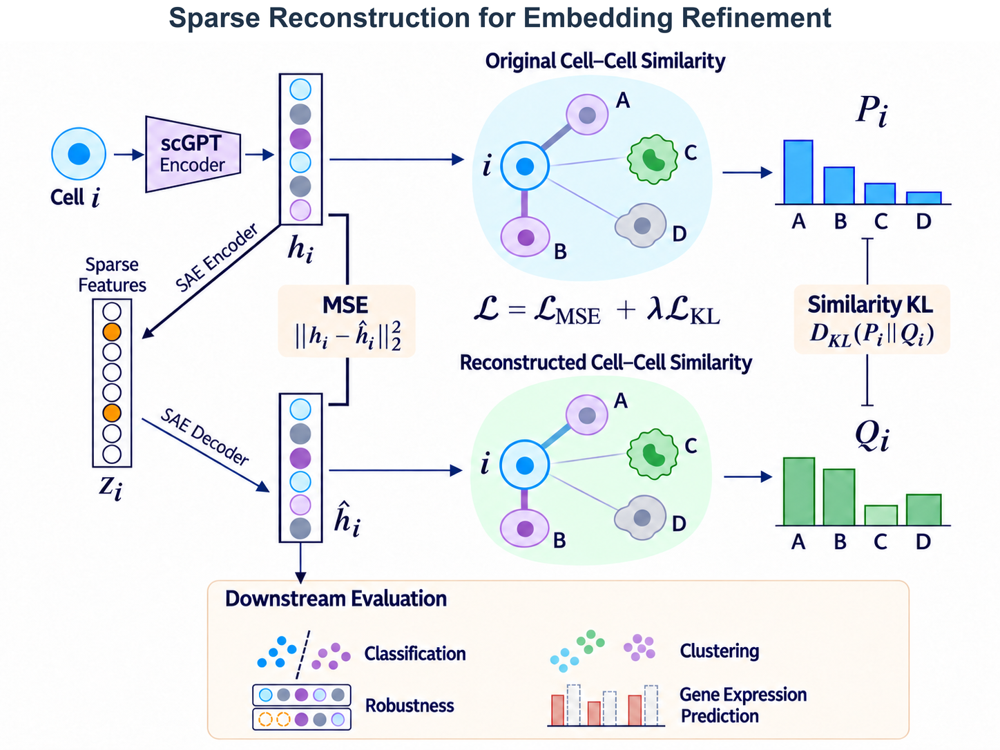
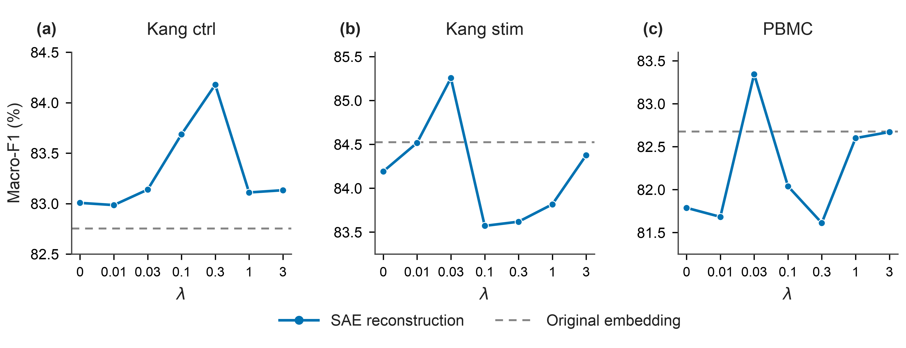

# scGPT SAE Refinement

**Interpreting and Refining scGPT Cell Embeddings with Structure-Preserving Sparse Autoencoders**

Authors: **Xia Haoxiang, Chang Runjia, Xiao Jiahao**. BS6204 course research project.

Frozen scGPT → 512-dimensional cell embedding → 2048-dimensional Top-K SAE
(`k=32`) → reconstructed cell embedding. We study cell-type-associated sparse
features, gene-input substitution attribution, and representation refinement
with MSE plus cell–cell similarity KL.

## Method overview



**Figure 1. Overview of structure-preserving sparse reconstruction.** A frozen
scGPT encoder produces cell embeddings, which a Top-K SAE decomposes into sparse
features and reconstructs. The objective combines point-wise reconstruction MSE
with KL alignment of original and reconstructed cell–cell similarity distributions.
The reconstructed representations are evaluated for downstream utility.

## Classification performance

**Table 1. Cell-type classification performance (Macro-F1, %).** Bold values
indicate the highest score in each dataset column. Improvements are expressed
in percentage points (pp).

| Representation | Kang ctrl | Kang stim | PBMC |
|:--|--:|--:|--:|
| Original embedding | 82.75 | 84.52 | 82.68 |
| SAE: MSE | 83.01 | 84.19 | 81.79 |
| SAE: MSE + KL (λ = 0.3) | **84.18** | 83.62 | 81.61 |
| SAE: MSE + KL (best λ) | **84.18** | **85.26** | **83.34** |
| Δ vs. original (best λ) | +1.42 pp | +0.73 pp | +0.67 pp |

*Selection note:* SAE scores report the best observed seed for each configuration;
“best λ” additionally selects the regularization weight. These exploratory
TEST-selected summaries are not multi-seed averages. The
[selection registry](figures/data/selection_registry.csv) and
[source table](figures/data/classification_table.csv) retain the full provenance.

## Sensitivity to the KL regularization weight



**Sensitivity to λ.** Blue curves show SAE reconstruction performance; dashed
gray lines indicate the original-embedding baseline. Each point follows the
best-observed-seed reporting rule used in Table 1. The tested weights are
λ ∈ {0, 0.01, 0.03, 0.1, 0.3, 1, 3}, where λ = 0 is MSE-only reconstruction.
The highest observed scores occur at λ = 0.3 for Kang ctrl and λ = 0.03 for Kang
stim and PBMC. The non-monotonic curves show that the effect of relational
regularization depends on the dataset and its weight.

[Vector PDF](figures/images/lambda_sensitivity.pdf) ·
[Vector SVG](figures/images/lambda_sensitivity.svg) ·
[Source data](figures/data/lambda_best_seed_curve.csv)

## Start here

- [Paper PDF](paper/report.pdf) · [Overleaf ZIP](paper/overleaf.zip) · [LaTeX source](paper/latex/main.tex)
- [Detailed project handoff (Chinese)](handoff/PROJECT_HANDOFF.md)
- [How to run and what is reproducible](docs/REPRODUCIBILITY.md)
- [Code / experiment map](docs/CODE_MAP.md) · [Data and external assets](docs/DATA.md)
- [Release checks](RELEASE_VALIDATION.json)

## Quick start

Use Python 3.9–3.12 and a fresh environment:

```bash
python -m venv .venv
source .venv/bin/activate
python -m pip install -e '.[figures]'
python scripts/verify_release.py
python handoff/verify_handoff.py
python figures/plot_results.py
python figures/plot_secondary.py
python -m unittest discover -s tests -v
```

Figure 5, Figure 6 and the classification table can be regenerated from included
CSV files without downloading RNA data or model weights. Figures 1–4 and their
available source scripts / evidence are also included.

## Continue SAE refinement from cached embeddings

```bash
sae-refine --cache /path/to/kang_embeddings.npz \
  --splits /path/to/fold0.json --checkpoint /path/to/sae.pt \
  --anchor-mode cross-group --lambda-kl 0.3 --seed 42 --fold 0 \
  --out runs/ctrl_fold0_seed42_lambda03
```

This portable CPU entry point reuses the original SAE, KL and balanced Ridge
mathematical definitions. It requires an existing TRAIN-fitted SAE checkpoint
and explicit TRAIN/VALID/TEST indices. It is **not** an automatic reproduction of
all historical paper experiments. See the reproduction guide for warmup,
checkpoint requirements, PBMC differences, and the archived complete workflows.

## Contents

| Folder | Contents |
|---|---|
| `src/sae_refinement/` | Portable continuation CLI and original mathematical definitions |
| `archive/work/` | Original SAE analysis, training, attribution, pathway and evaluation scripts |
| `archive/historical_project/` | Initial Top-K SAE, data preparation and scGPT extraction code |
| `archive/upstream/` | Original scGPT loading dependency |
| `results/` | Historical aggregate metrics, experiment protocols and verification records |
| `figures/` | Portable conference figure/table regeneration and source CSVs |
| `handoff/` | Detailed Chinese handoff, figure data and independent arithmetic verification |
| `paper/` | Latest report PDF, LaTeX, references and Overleaf project |
| `tests/` | Sparse forward, KL-gradient, split-leakage and Ridge consistency checks |

## Interpretation of the results

- Raw-value Top-K retains selected signs; there is **no ReLU**. Decoder columns
  are normalized, with a fixed TRAIN mean and no learned decoder bias.
- KL compares original–original and reconstructed–reconstructed similarities.
  Kang uses cross-TRAIN-donor anchors; PBMC uses non-self source-batch anchors.
- Expression prediction / masking robustness use a **separate expression-supervised
  SAE branch**. They are not all results of the MSE+KL model.
- The displayed best-seed / best-lambda table is exploratory TEST-selected
  reporting, not a multi-seed mean or an unbiased prospective estimate. The
  full metrics and selection registry are included; benefits are task-dependent.
- Gene-input substitution measures model sensitivity; it does not establish
  biological causality or pathway activation.

## Scope of this release

The release contains project source code, result summaries, plots and the paper.
Raw `.h5ad`, pretrained scGPT weights, SAE checkpoints, per-cell embedding caches,
virtual environments, credentials and training checkpoints are not redistributed.
The archive deliberately preserves original paths and hash bindings as historical
provenance; those scripts require path adaptation and the original inputs.

No publication or conference acceptance is implied by the manuscript template.
Third-party scGPT code/weights and the NeurIPS style retain their original terms.
No blanket license is assigned to third-party assets by this repository.
