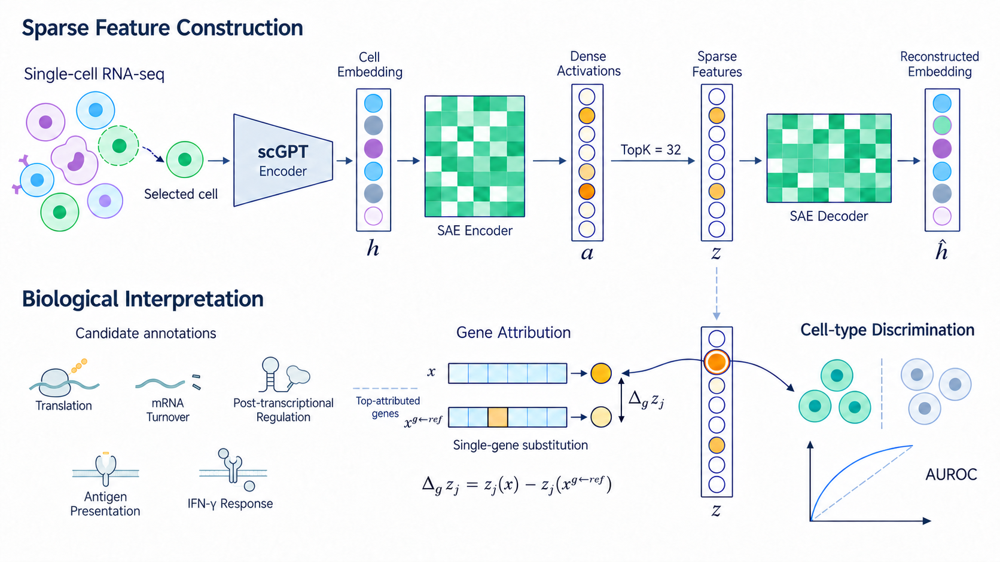
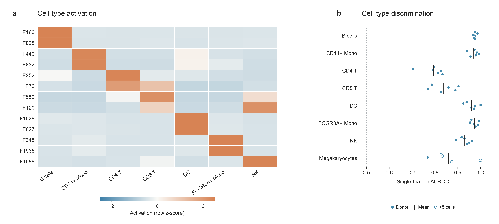
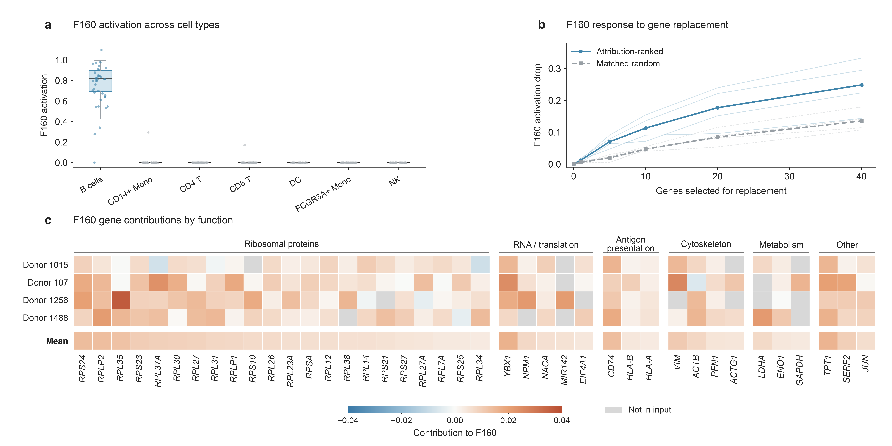
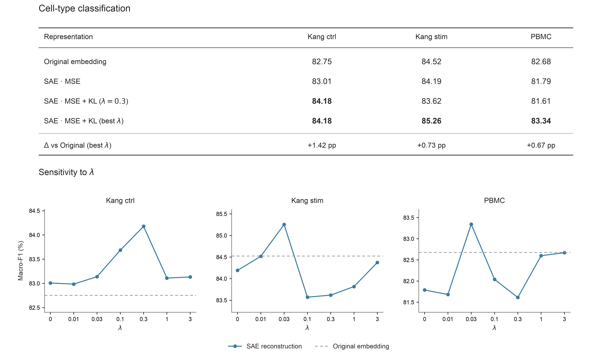
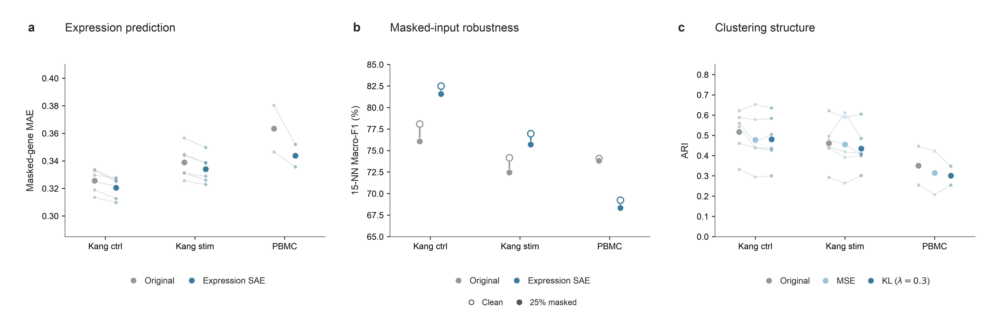

# scGPT × SAE 项目交接：可解释性分析与细胞表征优化

更新日期：2026-10-21  
用途：小组作业、报告撰写、图表解读，以及向组员的 Codex 交接上下文。  
状态：已有实验结果的整理；不是预注册研究，也不是“所有任务均稳定提升”的结论。

## 先读这里

本项目围绕两个连续的问题展开：

1. **解释问题**：scGPT 生成的稠密细胞 embedding 中，能否提取与细胞身份相关、并能追溯基因贡献的稀疏特征？
2. **优化问题**：这些稀疏特征经过重建，能否反过来改善 embedding 的下游可用性？加入细胞关系约束是否有帮助？

主要方法是冻结 scGPT，在其 512 维细胞 embedding 上训练 TopK SAE：先映射到 2048 维激活，再保留每个细胞最大的 32 个激活，最后解码回 512 维。可解释性部分分析稀疏特征；优化部分使用重建后的 embedding。

目前支持的主要观察：

- 多个 SAE 特征与细胞类型具有较强关联，但不同细胞类型的单特征判别能力不同。
- B 细胞案例 F160 可以通过基因输入替换分析其响应；高贡献基因包含核糖体蛋白、RNA/翻译、抗原呈递等已有注释类别。这是候选功能解释，不是机制或因果证明。
- MSE＋KL 的分类效果依赖数据集、λ 和种子。最佳运行可以优于原始 embedding，但多种子平均并没有在所有数据集复现这种提升。
- 表达监督 SAE 在合理的验证集 checkpoint 选择后，改善了当前遮蔽表达预测任务；它是**另一条实验分支**，不是 MSE＋KL 模型。
- 分类、表达预测、鲁棒性和聚类不保证同步改善。尤其 PBMC 的表达预测改善并未带来更好的近邻分类表现。

**最重要的三条阅读约束：**

> ① 不把 Figure 5 中不同训练目标的结果，合并解释为一个模型的全面提升。  
> ② 不把主表的最佳 TEST 种子结果写成三种子平均或无偏泛化估计。  
> ③ 不把基因贡献、功能分组或模型输入扰动解释成生物调控因果关系。

### 建议阅读顺序

- 只需要理解故事：读第 1、5、6、7、8 节。
- 需要写 Methods：重点读第 2、3、4 节。
- 需要复核数字或继续用 Codex：读第 9、10、11 节，并检查配套 CSV/JSON。

## 目录

1. [研究动机与故事主线](#1-研究动机与故事主线)
2. [数据、预处理与划分](#2-数据预处理与划分)
3. [模型结构与实际优化目标](#3-模型结构与实际优化目标)
4. [生物可解释性分析的方法](#4-生物可解释性分析的方法)
5. [逐张图表说明](#5-逐张图表说明)
6. [分类、λ 扫描与种子选择](#6-分类λ-扫描与种子选择)
7. [表达预测、鲁棒性与聚类](#7-表达预测鲁棒性与聚类)
8. [可以怎么写结果与讨论](#8-可以怎么写结果与讨论)
9. [配套文件与来源索引](#9-配套文件与来源索引)
10. [复现与迁移到其他电脑](#10-复现与迁移到其他电脑)
11. [给接手 Codex 的说明](#11-给接手-codex-的说明)
12. [参考文献与待完善事项](#12-参考文献与待完善事项)

## 1. 研究动机与故事主线

### 1.1 为什么从 scGPT embedding 开始

scGPT 将基因与表达信息编码为细胞表征。这种表征可能对分类有效，但单个坐标并不天然对应清晰的细胞类型或功能。

我们希望把“表征中有什么”与“表征是否更有用”分开检验：

- 先用 SAE 寻找更易分析的稀疏坐标。
- 再检验重建后的表征是否具有更好的下游读出，而不预设可解释性一定带来性能提升。

这也解释了为什么第一部分和第二部分相连，但不能互相替代：高 AUROC 的可解释特征，不自动等于更好的整体 embedding。

### 1.2 本项目中 refine 的含义

本项目主要指：**冻结 scGPT，在它的输出空间中训练额外的 SAE，并以 SAE 重建结果作为新的细胞表征。**

它不是：

- 微调 scGPT 主干；
- 给模型增加新的观测模态；
- 证明 SAE 特征具有跨任意数据集的直接迁移能力。

当前优化实验中，ctrl、stim、PBMC 分别使用本数据集、本划分、本种子的 SAE。PBMC 优化表不是“把 Kang SAE 直接用于 PBMC”的迁移结果。

### 1.3 为什么最终选择 MSE＋KL 这条主线

之前探索过拼接、门控残差、低秩残差、重建/残差分解等方案。这些实验没有建立稳定的 SAE 特有提升证据，且有些结果受到读出尺度、正则化或模型选择的影响。

因此当前主线收敛到一个更容易解释和检验的方案：

> 在稀疏表示约束下，既保留单个细胞 embedding 的信息，又保留细胞之间的相对相似关系。

历史残差实验与当前主表可能使用不同的 PBMC 协议，不能直接横向拼数。本交接文档不把早期聊天中的数值当作当前表的来源；以随包源表为准。

## 2. 数据、预处理与划分

### 2.1 本轮主要数据

| 数据 | 当前纳入细胞数 | 分组单位 | 用途 |
|---|---:|---|---|
| Kang ctrl | 9,577 | 6 个供体 | 主要解释性分析、分类、λ 扫描及多项评估 |
| Kang stim | 9,728 | 与 ctrl 对应的 6 个供体 | 条件扩展、分类与多项评估 |
| PBMC | 4,638 | 2 个批次 | 数据集内 SAE refinement 与跨批次评估 |

共同的 8 个细胞类型：

`B cells`、`CD14+ Monocytes`、`CD4 T cells`、`CD8 T cells`、`Dendritic cells`、`FCGR3A+ Monocytes`、`Megakaryocytes`、`NK cells`。

需要注意：

- ctrl 与 stim 共享供体，不能当成两组完全独立的生物学队列。
- PBMC 的两个组是批次，不能称为两个已经验证的独立供体。
- 文件名 `PBMC368k_raw.h5ad` 不代表本轮实际分析了 368,000 个细胞；实际纳入为 4,638。
- 当前历史材料没有充分建立这些样本与 scGPT 预训练数据之间完全无重叠，不应写成已验证的预训练外泛化。
- 数据集的正式来源、下载版本与原论文引用，正式提交前仍需对照原始数据来源补齐；本包提供本地来源路径与原始 manifest，不凭文件名推断完整来源。

### 2.2 原始数据与 embedding

原作者电脑上的输入：

```text
/Users/apple/Desktop/Llava-Cell/dataset/kang.h5ad
/Users/apple/Desktop/Llava-Cell/dataset/PBMC368k_raw.h5ad
/Users/apple/Desktop/scGPT/scGPT_human/
```

历史 embedding 与 SAE 起始模型目录：

```text
/Users/apple/.codex/.chatgpt-projects/g-p-6abd227c77ec8191b96f942248d505b7/experiments/sae_topk_20261014/
```

其中关键文件：

- `kang_embeddings.npz`
- `pbmc_embeddings.npz`
- `data_manifest.json`
- `test_<donor>/seed_<seed>/k_32/sae.pt`
- `test_<donor>/seed_<seed>/k_32/sae_outputs.npz`

stim 与 PBMC 扩展的规范缓存位于当前工作区：

```text
work/sae_extension/data/stim.npz
work/sae_extension/data/pbmc.npz
```

**这些大体积 RNA、embedding 和模型权重没有包含在此次轻量分享包中。** 随包的是图表、指标、协议及关键源代码参考。

### 2.3 预处理和 pooling

当前实现的关键设置：

- 基因映射至 scGPT 词表。
- 使用表达基因 token，序列长度上限 512，并处理 padding。
- 表达值采用单细胞归一化、`log1p` 和分箱；配置为 51 个 bins，具体边界及相同表达值处理以历史 tokenizer 为准。
- 输入至少包含 16 个词表内表达基因。
- scGPT 全程冻结，当前缓存使用最终第 12 层输出。
- 对非 padding gene-token 隐状态进行**有符号均值 pooling**，得到 512 维向量。
- **不是 CLS pooling，不取隐状态绝对值，也不是把所有层平均。**

历史配置中仍可见 `excluded_cell_types=["Megakaryocytes"]` 字段，它来自更早的七类分析；后续 `prepare.py` 明确补回巨核细胞并构造八类缓存。判断实际队列应检查 `classes`、缓存标签和执行代码，不能仅引用遗留字段。

### 2.4 Kang 的六折划分

每折为 4 个 TRAIN 供体、1 个 VALID 供体、1 个 TEST 供体。

| 折 | TEST | VALID | TRAIN |
|---|---|---|---|
| 0 | patient_1016 | patient_1039 | 1015、1488、1256、107 |
| 1 | patient_1039 | patient_1015 | 1016、1488、1256、107 |
| 2 | patient_1015 | patient_1488 | 1016、1039、1256、107 |
| 3 | patient_1488 | patient_1256 | 1016、1039、1015、107 |
| 4 | patient_1256 | patient_107 | 1016、1039、1015、1488 |
| 5 | patient_107 | patient_1016 | 1039、1015、1488、1256 |

表中 TRAIN 的数字省略了 `patient_` 前缀。另两个历史保留供体 `patient_1244`、`patient_101` 没有纳入当前六供体主结果。

- SAE 拟合使用 TRAIN embedding。
- warmup 的重建 checkpoint 选择使用 VALID。
- 分类 Ridge 的正则化参数使用 VALID。
- TEST 用于报告性能；但这些 TEST 后续已经被多轮探索，因此当前总结仍属于历史探索性结果。

### 2.5 PBMC 的划分

PBMC 使用两个批次方向：

1. 一个批次作为 source，另一个批次整体作为 TEST。
2. 在 source 批次内，按类别固定划分约 20% 细胞为 VALID，其余为 TRAIN。
3. 交换 source/TEST 批次后再做一次。

PBMC 的 TRAIN 与 VALID 来自同一 source 批次，这是实际设计；不能写成三个独立批次分别用于 TRAIN/VALID/TEST。

### 2.6 如何汇总

通常先在每个留出组内部平均三个 SAE 种子，再对组等权平均。Kang 为 6 个供体，PBMC 为 2 个批次方向。

当前展示版 Table 1 改为按配置取**三个种子中 TEST 组平均成绩最高者**。这个“最佳种子”是在所有留出组上共同选一个种子，**不是每个供体单独挑最好种子后再拼接**。

## 3. 模型结构与实际优化目标

### 3.1 符号

| 符号 | 含义 |
|---|---|
| \(x_i\) | 细胞 \(i\) 的转录组及其模型输入 |
| \(h_i\in\mathbb R^{512}\) | 冻结 scGPT 的原始细胞 embedding |
| \(\mu\) | 仅由 TRAIN embedding 计算并固定的均值 |
| \(a_i\in\mathbb R^{2048}\) | SAE 稀疏化前的激活 |
| \(z_i\in\mathbb R^{2048}\) | TopK 后的稀疏特征 |
| \(\hat h_i\in\mathbb R^{512}\) | SAE 重建 embedding |
| \(D\) | SAE decoder 字典矩阵 |
| \(\lambda\) | 关系 KL 损失权重 |

### 3.2 SAE 的 forward

\[
a_i=W_e(h_i-\mu)+b_e,
\qquad
z_i=\operatorname{TopK}_{32}(a_i),
\qquad
\hat h_i=Dz_i+\mu.
\]

实现细节：

- 先生成 dense activations，再执行 TopK。
- 主方法按**原始激活数值大小**选最大的 32 个，不是按绝对值。
- 保留被选中的原始符号；没有先经过 ReLU。严格表述为“非零数不超过 32”，而不是保证每个保留值都为正。
- Encoder 有偏置；Decoder 没有可训练偏置，加回的是固定 TRAIN 均值。
- Decoder 每列在更新后归一化为单位范数。
- 稀疏性来自 TopK，不是本轮额外的 L1 penalty。
- 稀疏表示 \(z\) 是分析对象；优化主表使用的是重建向量 \(\hat h\)，不是直接拿 \(z\) 分类。

SAE 属于自编码器家族，但这里的稀疏瓶颈是重要约束。它并不天然保证每个特征都是单一生物学概念。

### 3.3 MSE：保留单细胞向量

图中的简化表达是：

\[
\mathcal L_{\mathrm{MSE},i}\propto\|h_i-\hat h_i\|_2^2.
\]

代码实际使用 TRAIN 尺度归一化：

\[
s_{\mathrm{train}}^2=
\frac{1}{N_{\mathrm{train}}d}
\sum_{i\in\mathrm{TRAIN}}\|h_i-\mu\|_2^2,
\]

\[
\mathcal L_{\mathrm{MSE}}
=
\frac{\frac{1}{Bd}\sum_{i\in\mathcal B}\|h_i-\hat h_i\|_2^2}
{s_{\mathrm{train}}^2},
\quad d=512.
\]

因此 λ 的数值必须结合这个归一化理解。如果改用未归一化 MSE，相同 λ 不再具有相同的相对权重。

### 3.4 KL：保留细胞间相似分布

原始与重建侧都使用同一个固定 TRAIN 均值进行中心化：

\[
u_i=\frac{h_i-\mu}{\|h_i-\mu\|_2},\qquad
v_i=\frac{\hat h_i-\mu}{\|\hat h_i-\mu\|_2}.
\]

实际代码对范数加数值保护。对当前 query \(i\) 的允许比较集合 \(\mathcal A_i\)，定义：

\[
P_{ij}=
\frac{\exp(u_i^\top u_j/\tau)}
{\sum_{k\in\mathcal A_i}\exp(u_i^\top u_k/\tau)},
\]

\[
Q_{ij}=
\frac{\exp(v_i^\top v_j/\tau)}
{\sum_{k\in\mathcal A_i}\exp(v_i^\top v_k/\tau)},
\qquad \tau=0.1.
\]

\[
\mathcal L_{\mathrm{KL}}
=\frac1B\sum_i
\sum_{j\in\mathcal A_i}P_{ij}\log\frac{P_{ij}}{Q_{ij}}.
\]

关键点：

- \(P\) 来自原始 embedding；teacher 分支停止梯度。
- \(Q\) 来自**重建 query 与重建 anchor**。
- **不是**计算 \(\operatorname{sim}(\hat h_i,h_j)\)。
- 两边比较的是同一批对应细胞，概率按 query 的允许 anchors 归一化。
- 不是对细胞类型概率做 KL，也不是对 SAE 特征 \(z\) 的分布做 KL。
- 这是 sampled cell-cell similarity 的保真约束，不是已测得的真实生物学流形或细胞轨迹。

### 3.5 Kang 和 PBMC 的 anchor 集合不同

| 数据 | batch | 允许比较的 anchors | 每个 query 数量 |
|---|---:|---|---:|
| Kang ctrl/stim | 256；4 个 TRAIN 供体各 64 个细胞 | 当前 batch 中其他 TRAIN 供体的细胞 | 192 |
| PBMC | source TRAIN 批次中抽 256 个细胞 | 当前 batch 中除自己外的其他细胞 | 255 |

Kang 采用跨供体比较，意在约束不同训练供体间的几何关系，但不等于自动去除批次效应。

PBMC 的 source TRAIN 中只有一个批次，且没有已验证 donor ID，因此实际使用 non-self 的同批次关系。没有人为生成“伪供体”，也没有把 TEST 批次加入训练关系图。

### 3.6 总目标与训练设置

\[
\boxed{\mathcal L=\mathcal L_{\mathrm{MSE}}+\lambda\mathcal L_{\mathrm{KL}}}
\]

固定扫描：

\[
\lambda\in\{0,\ 0.01,\ 0.03,\ 0.1,\ 0.3,\ 1,\ 3\}.
\]

主要设置：

- SAE 宽度 2048，TopK 32；种子 42、43、44。
- 各数据集/划分/种子先有 MSE warmup，同一组所有 λ 从相同 warmup 状态开始。
- warmup 最多 20 epochs，依据 VALID MSE 选取，使用既有固定规则。
- MSE/KL continuation 固定额外 1,000 步，batch size 256。
- Adam，无 weight decay；学习率余弦衰减 \(3\times10^{-4}\to10^{-5}\)。
- 同一划分/种子不同 λ 共用保存的 minibatch 索引。
- continuation 使用最后一步，不用 TEST 挑训练 checkpoint；期间监控不等于用监控曲线选最优点。
- 当前展示的最佳种子/最佳 λ 是之后的结果整理选择，与训练时固定 checkpoint 规则是两件事。

### 3.7 为什么重建原 embedding 仍可能改变下游性能

MSE 和 KL 都向原始表征提供教师信号，**不是两个相互对立的生物学目标**。它们约束的层面不同：一个约束向量坐标，一个约束相对关系。

由于 TopK 瓶颈、有限字典和有限训练预算，SAE 通常不能无误差复制所有 embedding。重建可能重新分配误差、抑制一些变化，也可能丢失有用信息。是否有利取决于下游任务。

因此合理说法是“带稀疏约束的关系保持重建可能改变下游可读性”，而不是“KL 必然纠正了原 embedding 的生物学错误”或“已经证明去噪”。

### 3.8 分类读出

分类主指标为固定 8 类 Macro-F1。

- 每个表征独立使用 TRAIN 均值/标准差进行通道标准化。
- 类别平衡的加权 Ridge，含截距，目标为 \(2\,\mathrm{onehot}(y)-1\)。
- 正则化候选为 \(10^{-4},10^{-3},\ldots,10^6\)，共 11 个。
- 根据 VALID 固定八类 Macro-F1 选择，平局按既定升序规则处理。
- 不将 TRAIN＋VALID 合并重新拟合。
- 固定八类指标中，某 TEST 组缺失的类别按实现的零分规则参与；另有 supported Macro-F1，但不能替换主指标后沿用同一名字。
- 当前主表是 Ridge 分类，不是 Figure 3 的单特征 AUROC，也不是 Figure 5 的 15NN 读出。

## 4. 生物可解释性分析的方法

### 4.1 解释性主模型

B 细胞案例与 Figure 3a 采用历史主模型：

- 数据：Kang ctrl；
- TEST：patient_1016；
- VALID：patient_1039；
- TRAIN：patient_1015、patient_1488、patient_1256、patient_107；
- seed 42，TopK 32。

**F160 是该字典内的编号。** 不同种子、数据集或重新训练的 SAE，其 F160 不自动表示同一概念。当前 F160 案例也不是证明所有 MSE＋KL 优化模型保留了同一个特征身份。

### 4.2 细胞类型关联

Figure 3a 沿用此前 TRAIN 选择的 13 个细胞类型相关特征。热图在 TEST 供体中计算每类的平均激活，再对每个特征的图示类别均值做 row z-score。

- 高颜色值表示该特征在某一类中相对更活跃。
- row z-score 不能用于比较不同特征的绝对激活大小。
- 只展示该 TEST 供体中至少 20 个细胞的类别；巨核细胞只有 1 个，因此左图不显示。

Figure 3b 对全部 8 类做 one-vs-rest 的单特征 AUROC：

1. 每个训练划分、种子独立筛选候选特征。
2. 候选特征需在 TRAIN 总非零数至少 20、非零频率不超过 0.5、每个 TRAIN 供体至少 3 个非零。
3. 优先最大化 TRAIN 供体 AUROC 的最小值；平局依次按平均 AUROC、较小编号选择。
4. 使用选定特征的正向原始激活，在对应 TEST 供体计算 AUROC。
5. 三个种子先在同一 TEST 供体内平均，再统计供体均值与 SD。

若某 TRAIN 供体没有目标类别，其 AUROC 未定义，选择时排除这项未定义值，但仍保留每供体的非零覆盖要求。TEST 中没有正类时标为不可计算，**不填成 0.5**。

Figure 3b 验证的是“各划分能否选出具有判别能力的特征”，不是“左图同一个编号在六供体都稳定复现”。

### 4.3 Gene Attribution：单基因输入替换

令 \(s_j(x)=z_j(f_{\mathrm{scGPT}}(x))\)。对目标细胞 \(x_i\)、参考细胞 \(x_r\)、基因 \(g\)：

\[
\Delta_{g,j}(i,r)
=s_j(x_i)-s_j(x_i^{g\leftarrow r}).
\]

\(x_i^{g\leftarrow r}\) 的含义是：**保留原来的 gene tokens 和 padding，只把基因 \(g\) 的输入分箱值替换为参考细胞中对应的值**，然后重新运行冻结 scGPT 和 SAE。

- 正贡献：替换后目标特征激活下降。
- 负贡献：替换后目标特征激活上升。
- 这不是梯度归因、不是单纯表达相关系数，也不是直接将原始 count 做基因敲除。
- 替换不会在此归因实验中重新选择所有 tokens 或重新归一化整个细胞。
- 其含义是模型对一种参考依赖输入变化的敏感性。

**注意：归因替换与后面 MAE 实验的遮蔽处理不同。** MAE 分支会隐藏 token 并重算可见表达的分箱/归一化，不能混写成同一个输入干预。

### 4.4 F160 的原型、参照与平均方式

- TRAIN：四个供体，每个选两个 F160 高激活 B 细胞，共 8 个原型。
- 每个原型使用至多三个同供体、同细胞类型、F160 为零的近邻参照。
- 先对参照平均，再对同供体两个原型平均，最后对四个供体等权平均。
- TEST：在 patient_1016 中选四个高激活 B 细胞，用于累计基因替换曲线。
- TEST 四个细胞不是四个独立供体；原型经过高激活选择，也不是随机抽取的全部 B 细胞。

### 4.5 功能热图与 pathway 的区别

Figure 4c 使用 TRAIN 平均贡献最高的 40 个正贡献基因，固定该集合后按功能注释分组。

六组为：

| 显示分组 | 例子 |
|---|---|
| Ribosomal proteins | RPS24、RPLP2、RPL35 等 RPL/RPS 基因 |
| RNA / translation | YBX1、NPM1、NACA、MIR142、EIF4A1 |
| Antigen presentation | CD74、HLA-B、HLA-A |
| Cytoskeleton | VIM、ACTB、PFN1、ACTG1 |
| Metabolism | LDHA、ENO1、GAPDH |
| Other | TPT1、SERF2、JUN |

分组依据已有 MSigDB 2025.1 human GO BP/Reactome 成员关系和 RPL/RPS 命名规则。一个基因可有多种功能，图中为减少重复只显示一次；完整注释与 NPM1 的展示归组例外保存在源表。

热图：

- 行：四个 TRAIN 供体及 Mean。
- 列：固定 top40 基因，组内按原始 TRAIN 贡献排序。
- 颜色：原始有符号贡献，不是表达量，不是 row z-score，也不是 pathway activity。
- 色标：对称 \([-0.04,0.04]\)。
- 某供体两个原型都没有输入该基因 token 时显示灰色；原有均值计算仍按缺失 token 贡献计零。
- 一个原型有 token、另一个没有时，显示含零填充的平均值；覆盖度可在 CSV 中查。

**这些分区不等于显著富集。** 此前五个候选功能条目没有通过匹配随机的全局 FDR<0.05。本项目可以说“高贡献基因涉及这些已有功能类别”，不能说“这五条通路已被显著激活”。

## 5. 逐张图表说明

本包图片来自用户整理的 `/Users/apple/Desktop/6204 Figure/`，对应截图中的六个文件。历史程序中曾用过其他 Figure 编号，**以本节映射为当前命名**。

### Figure 1：模型流程图


讲解顺序：

1. scGPT 产生原始细胞向量 \(h_i\)。
2. SAE 将 \(h_i\) 稀疏化成 \(z_i\)，再重建 \(\hat h_i\)。
3. MSE 约束单细胞向量误差。
4. 原始/重建细胞间相似度分别转成 \(P_i,Q_i\)，再计算 KL。
5. 评估分类、聚类、鲁棒性和表达预测。

图是方法示意：

- A/B/C/D 只是示意 anchors，不是特定细胞类型或真实二维投影坐标。
- 图上 MSE 省略了 batch/维度平均和 TRAIN 尺度归一化；Methods 应使用第 3 节的完整定义。
- 下方四项表示研究中考虑的评估方向，**不代表 Figure 5 的所有结果都来自这个 MSE＋KL 模型**。正式报告需要在图注指出表达监督扩展分支，或后续统一模型再补算。

### Figure 2：可解释性流程图



上层是特征构建：细胞→scGPT→\(h\)→dense activations \(a\)→TopK→\(z\)→重建。

下层围绕选中的稀疏特征：

- 右侧：细胞类型判别，可用 AUROC 衡量。
- 中间：单基因替换，测量激活变化。
- 左侧：根据高贡献基因已有注释形成候选功能解释。

图中的功能 icons 是分析方向的抽象示意，不是显著富集结果。例如 IFN-γ 图标不能直接作为当前 stim 干预类型、F160 特异性或通路激活的证据。

### Figure 3：全细胞激活值分析



左图为单个主模型的激活图谱，右图为独立训练选择后在留出供体上的判别能力。

| 细胞类型 | 供体平均 AUROC | 供体间 SD | 有效 TEST 供体 |
|---|---:|---:|---:|
| B cells | 0.9756 | 0.0058 | 6 |
| CD14+ Monocytes | 0.9705 | 0.0188 | 6 |
| CD4 T cells | 0.7939 | 0.0472 | 6 |
| CD8 T cells | 0.8394 | 0.0542 | 6 |
| Dendritic cells | 0.9609 | 0.0269 | 6 |
| FCGR3A+ Monocytes | 0.9737 | 0.0153 | 6 |
| NK cells | 0.9313 | 0.0250 | 6 |
| Megakaryocytes | 0.8600 | 0.0863 | 5 |

巨核细胞在 patient_107 中为零，另五个供体的数量范围为 1–52，其中四个只有 1–4 个。它只能作为稀有类的描述性补充。

主要信息：很多类别可通过单个特征较好地区分，但 CD4/CD8 T 的单特征判别相对弱。不能据此说整个 SAE 表征不能区分 T 细胞。

源文件：[AUROC 汇总](data/figure3/panel_B_summary.csv)、[每供体结果](data/figure3/panel_B_donor_AUROC.csv)、[每折/种子选中特征](data/figure3/panel_B_selected_features_by_fold_seed.csv)。

### Figure 4：B 细胞案例



- **a 激活分布**：F160 在 B 细胞中更活跃。箱线统计用全部细胞，展示散点仅抽样；不把抽样点数当样本量。
- **b 累计基因替换**：按 TRAIN 归因排序替换基因，与匹配随机基因对照。请求替换 40 个基因时，平均激活下降分别为 **0.248289** 与 **0.135295**。这支持排序对当前特征响应的解释价值，但不是基因功能实验。
- **c 功能贡献热图**：把固定 top40 按注释分组，展示供体间贡献差异与输入覆盖情况，是本图的主体。

随机对照匹配原始分箱、参照替换方向与替换幅度；每原型十个随机集平均。横轴是“请求替换数”，不是保证所有原型都有对应数量的实际可替换输入基因。

本图不加显著性星号。a/b 用历史 TEST 供体，c 用 TRAIN 四供体；这些角色不能在图注中互换。

源文件：[热图数值](data/figure4/heatmap_source_data.csv)、[基因功能依据](data/figure4/gene_groups_and_evidence.csv)、[替换曲线](data/figure4/panel_C_mean_replacement.csv)。源文件名 `panel_C_*` 沿用旧版命名，当前 Figure 4 中对应的是 **b**。

### Table 1：分类主表与 λ 扫描



上方表格展示当前最佳运行；下方展示各 λ 的最佳种子包络。完整数值与选择偏差见第 6 节。

### Figure 5：其他性能比较



这是一张**已有不同实验分支的结果汇总图**：

- a：表达监督 SAE 的 masked-gene MAE；
- b：同一个表达监督 SAE 的 clean/25% masked 15NN 性能；
- c：MSE 与 MSE＋KL（固定 λ=0.3）的 ARI。

它不支持“Table 1 中最佳模型同时获得 a/b/c 所有表现”的说法。完整实验身份和数值见第 7 节。

## 6. 分类、λ 扫描与种子选择

### 6.1 当前展示版主表

指标为 Macro-F1（%），各留出组等权。

| 表征 | Kang ctrl | Kang stim | PBMC |
|---|---:|---:|---:|
| Original embedding | 82.7540 | 84.5250 | 82.6761 |
| SAE · MSE，最佳种子 | 83.0071 | 84.1916 | 81.7880 |
| SAE · MSE＋KL，λ=0.3，最佳种子 | 84.1781 | 83.6185 | 81.6121 |
| SAE · MSE＋KL，扫描最佳 λ/种子 | 84.1781 | 85.2552 | 83.3447 |
| 扫描最佳相对 Original | +1.4241 pp | +0.7303 pp | +0.6686 pp |

图面保留两位小数，此处多留位数方便核对。

### 6.2 当前展示实际用了哪些种子

种子编号不在图面标注，但交接必须保留：

| 数据 | MSE 最佳种子 | 固定 λ=0.3 最佳种子 | 扫描最佳 λ | 扫描最佳种子 |
|---|---:|---:|---:|---:|
| ctrl | 42 | 42 | 0.3 | 42 |
| stim | 43 | 42 | 0.03 | 43 |
| PBMC | 43 | 43 | 0.03 | 43 |

完整记录：[selection_registry.csv](data/performance/selection_registry.csv)。

不要把这里的“best”改写为“VALID-selected best seed”。这次整理确实按照历史 TEST 汇总成绩选种子和展示 λ，属于探索性的最佳表现。

### 6.3 三种子平均的结果也需要知道

下面按原始统计协议：先在每个组内平均三个种子，再等权平均组。

| 表征/配置 | Kang ctrl | Kang stim | PBMC |
|---|---:|---:|---:|
| Original | 82.7540 | 84.5250 | 82.6761 |
| MSE | 82.7077 | 83.1558 | 80.0161 |
| MSE＋KL，λ=0.03 | 82.5805 | 84.1084 | 81.7473 |
| MSE＋KL，λ=0.3 | 83.4752 | 83.4995 | 80.4082 |

因此：

- ctrl 的 λ=0.3 在三种子平均上优于 Original 约 **0.7213 pp**。
- stim 和 PBMC 的上述多种子平均仍低于 Original。
- 原始完整扫描中，stim/PBMC 没有某个 λ 的三种子平均超过 Original。
- “最佳运行都提升”与“跨种子稳定提升”是两种不同结论，不能互换。

主表可以用于展示潜力；Discussion 应明确稳定性不足。不能只在内部交接知道选择偏差、对外表注完全省略。

### 6.4 λ 敏感性图怎么理解

每个 λ 的点取三个种子中的最高组平均成绩。不同 λ 的最佳种子可能不同：

- 它是最佳种子包络，包含 λ 与种子选择共同影响。
- 它不是一个固定种子的单因素曲线。
- 横轴是已测 λ 的离散类别，含 λ=0，不是严格的数值等距轴。
- 曲线连线仅帮助阅读，没有拟合未测参数。
- 灰色虚线是 Original。
- 三个小图纵轴范围不同，跨图比较应读取数字。

若后续要正式研究参数稳健性，应同时提供固定种子曲线或三种子均值及波动；当前数据已经保留，不需要为此重新训练。

## 7. 表达预测、鲁棒性与聚类

### 7.1 几条容易混淆的分支

| 分支 | 输入 | 训练目标 | 当前作用 |
|---|---|---|---|
| MSE SAE | clean \(h\) | 重建 clean \(h\) | 分类/聚类基础对照 |
| MSE＋KL SAE | clean \(h\) | 重建 \(h\)＋关系 KL | 主优化方法 |
| A：gene-masked embedding reconstruction | 遮蔽输入的 scGPT embedding | 恢复 clean \(h\) | 历史遮蔽实验 |
| C：masked expression reconstruction | 遮蔽输入的 scGPT embedding | 经 SAE 输出预测被遮蔽表达 | Figure 5a/b |
| C_selected | 同 C | 训练轨迹不变，按 VALID 表达目标选 checkpoint | Figure 5a/b 实际使用 |

“B：masked SAE concept reconstruction”曾讨论，但没有在当前实验中执行；不要因方案出现过就写成已有结果。

### 7.2 遮蔽与表达监督的实际定义

- 每细胞固定遮蔽原先选定的阳性表达 gene tokens 的 25%，至少 1 个。
- 遮蔽位置改为 padding，不重新补入其他基因。
- 遮蔽后排除隐藏基因 counts，重新计算可见部分的分箱与相关归一化，避免隐藏值直接留在输入中。
- 原始 token 选择源于阳性表达基因，因此基因被选中的身份仍是条件信息；不是未知基因集合的完全无条件插补。
- TRAIN 内选择 2048 个词表匹配、具有足够正表达支持的目标基因，按 TRAIN logCP10k 方差选取。
- C 分支通过 SAE 的 512 维重建输出接线性表达头。
- C 的训练损失是对遮蔽阳性 targets 的基因标准化表达 MSE；**没有叠加主方法的 embedding MSE＋KL**。
- 表达目标是 logCP10k，不是原始 counts，也不是 \(h\) 的坐标。

### 7.3 为什么追加 checkpoint 选择

最初固定 C 在第 1000 步结束。后来用公平的独立线性探针比较冻结原始/优化 embedding，固定 C1000 没有在主 MAE 指标上获胜。

随后补充了 checkpoint 选择：

- 固定候选步：0、25、50、100、200、500、1000；
- 根据完整 VALID 的标准化表达 MSE 取最早最小值；
- step 0 是已有 warmup SAE，不是随机未训练模型；
- 不改变原有训练轨迹，step1000 权重与之前 C1000 核对一致；
- 丢弃联合训练的表达头；
- 对冻结表征重新训练独立线性探针，使用匹配预算与 VALID raw MAE 选探针 checkpoint；
- 再将 ctrl 确定的规则原样用于 stim/PBMC。

这支持“checkpoint 选择会影响该表达任务”，不等于证明 SAE 本身对所有任务都更好。

### 7.4 Figure 5a：当前最佳表达种子的 MAE

| 数据 | Original | Expression SAE | 所用种子 |
|---|---:|---:|---:|
| ctrl | 0.325657 | 0.320528 | 44 |
| stim | 0.338902 | 0.334115 | 43 |
| PBMC | 0.363455 | 0.343820 | 43 |

原始与优化表征使用同种子的独立探针对照。种子按 C_selected 的 TEST MAE 选择；因此这些也是最佳展示，并非纯粹由 VALID 选择的最终无偏估计。

独立于最佳展示，之前三种子平均报告同样支持当前表达预测任务上的改善。详细均值与原始逐组记录见 `evidence/sae_checkpoint_extension/`。

### 7.5 Figure 5b：相同表达模型的遮蔽鲁棒性

沿用 a 的模型与种子，不为鲁棒性另挑一套种子：

| 数据 | Original clean | Original masked | Expression SAE clean | Expression SAE masked |
|---|---:|---:|---:|---:|
| ctrl | 78.1001 | 76.0808 | 82.5092 | 81.5896 |
| stim | 74.1794 | 72.4705 | 76.9844 | 75.7196 |
| PBMC | 74.0910 | 73.8242 | 69.2387 | 68.3457 |

指标为 **15NN Macro-F1（%）**，不是 Table 1 的 Ridge Macro-F1。使用 clean TRAIN 参考，分别评价 clean 和 masked TEST queries。

图中空心点是 clean，实心点是 25% masked，短线连接这两个已测条件。没有测多个 mask 比例，也没有做 UMI 测序深度下采样曲线。

PBMC 的 Expression SAE 绝对近邻分类性能更低，不能因为表达 MAE 更好就称其 embedding 全面更优。鲁棒性应同时看受扰动后的绝对成绩和下降幅度。

### 7.6 Figure 5c：聚类

当前设置：

- 每个 TEST 组内独立建图；
- 使用共同原始 TRAIN 均值中心化后的 cosine 15NN 图；
- Leiden RBConfiguration，主要 resolution=1.0；
- 算法随机状态固定为 20261019；
- 以原始细胞类型注释计算 ARI；
- 不用 TEST 标签选择 resolution。

当前图使用各 MSE/λ=0.3 配置按分类成绩挑出的种子：

| 数据 | Original ARI | MSE ARI | MSE＋KL（λ=0.3）ARI |
|---|---:|---:|---:|
| ctrl | 0.517800 | 0.478348 | 0.481158 |
| stim | 0.461209 | 0.455364 | 0.434822 |
| PBMC | 0.350990 | 0.315086 | 0.301031 |

MSE 种子为 ctrl42/stim43/PBMC43；KL 种子为 ctrl42/stim42/PBMC43。

**没有为 ARI 再单独挑最佳种子。** 因此它与历史“每个指标各自挑最好种子”的表可能不同。这一版更接近检验分类所选模型是否也改善聚类。

同时，stim/PBMC 这里是 λ=0.3，并非主表扫描最佳的 λ=0.03。当前没有把最佳 λ 的其他任务结果静默替换进来。

### 7.7 尚未完成的统一模型评估

若希望 Figure 1 的四个评估方向真正对应同一套 MSE＋KL 模型，需要补：

1. 对同一 checkpoint 做匹配的 masked-expression probe；
2. 对同一 checkpoint 做 clean/固定遮蔽的分类评估；
3. 对 stim/PBMC 的 λ=0.03 计算相同聚类指标；
4. 统一预先确定的种子/参数选择规则，再独立评价。

这些是下一步可做的工作，不是本包已经完成的结果。本轮交接没有追加训练。

## 8. 可以怎么写结果与讨论

### 8.1 推荐的整体叙事

**第一步：可解释坐标。**  
通过 SAE 将 scGPT 的稠密细胞表征分解为稀疏特征，并观察这些特征与细胞类型之间的关联。

**第二步：具体案例。**  
以 B 细胞相关特征 F160 为例，通过参考细胞驱动的单基因替换分析模型响应，再结合已有功能注释组织高贡献基因。

**第三步：反向利用。**  
进一步研究稀疏重建是否能反哺 embedding。在向量重建之外加入细胞相似关系 KL，测试分类和参数敏感性。

**第四步：任务依赖。**  
分类最佳运行存在改善，但多种子平均、聚类和不同数据集并不一致；表达监督分支表明特定目标与 checkpoint 选择能够影响某些下游任务。

### 8.2 可直接借鉴的概括

> 本项目从可解释性与下游可用性两个角度分析冻结 scGPT 表征。TopK SAE 提供了与细胞身份相关的稀疏坐标，并使特定特征能够通过基因输入替换进行分析。在表征优化方面，加入细胞相似关系约束的稀疏重建在部分配置下改善了分类性能，但收益依赖数据集、参数和随机种子。表达监督扩展进一步显示，适合目标任务的训练和模型选择可改善遮蔽表达预测，而这种收益不一定转化为聚类或跨批次近邻分类的全面改善。

### 8.3 可以说与不能说

| 可以说 | 不应据当前结果声称 |
|---|---|
| 存在细胞类型关联较强的 SAE 特征 | 每个 SAE 特征都对应单一生物学概念 |
| F160 的响应可由输入替换追溯到候选贡献基因 | 已证明这些基因调控 B 细胞命运或功能 |
| top40 中包含多个核糖体及抗原呈递注释基因 | 已证明显著通路激活或 B 细胞独有功能程序 |
| ctrl 的 λ=0.3 有平均分类收益 | 所有数据集均稳定提升 |
| 展示最佳种子存在较好成绩 | 展示数值代表三种子平均 |
| 表达监督选型改善当前 masked-positive MAE | KL 已改善基因表达预测 |
| PBMC 做了两个批次方向评估 | PBMC 有两个已验证独立供体 |
| KL 更重视原始表征的关系保真 | KL 保证保留真实细胞生物学流形 |

### 8.4 Discussion 应包含的限制

- 历史数据和 TEST 多轮探索，最佳选择存在乐观偏差。
- 六供体训练集在不同折间重叠；种子不是生物学重复。
- ctrl/stim 共享供体；PBMC 两个方向也不是两个独立新队列。
- 稀有类型细胞数不足，尤其巨核细胞。
- 基因归因依赖原型、参照、tokenization 和输入替换方式。
- 功能分组不等于富集显著，注释关联不等于机制。
- 解释性主 SAE 与后续优化 SAE 的特征身份没有被证明一一保持。
- Figure 5 各部分来自不同训练目标，暂不能统一成一个全面改善结论。
- 当前表达预测只针对选定阳性遮蔽 targets，不是所有基因包括零值的完整插补。
- 尚无独立新队列确认，也没有完整的多遮蔽强度/测序下采样验证。

## 9. 配套文件与来源索引

### 9.1 包结构

```text
SAE_group_handoff/
├── PROJECT_HANDOFF.md             # 本文：主阅读入口
├── SOURCE_MANIFEST.json           # 复制文件的原始位置、大小与 SHA256
├── verify_handoff.py              # 标准库即可运行的文件/指标核对
├── VERIFICATION.json              # 本次检查结果
├── figures/                      # 用户整理的六张 PNG；部分 PDF/SVG
├── data/
│   ├── figure3/                  # 激活热图、AUROC、细胞数量、选特征记录
│   ├── figure4/                  # F160 激活、贡献热图、基因注释、替换曲线
│   └── performance/              # 分类、λ、Figure5 的逐组结果和选择记录
├── evidence/                     # 历史协议、报告、审计和原始指标 CSV
│   ├── original/
│   ├── sae_lambda/
│   ├── sae_extension/
│   ├── sae_evaluation/
│   ├── sae_masked_ac/
│   ├── sae_expression_probe/
│   ├── sae_checkpoint_selection/
│   ├── sae_checkpoint_extension/
│   ├── sae_gene_attribution_v2/
│   └── sae_interpretability/
└── source_reference/             # 关键源文件参考；不是完整可运行仓库
```

### 9.2 最常用的入口

| 需求 | 随包文件 |
|---|---|
| 查 Figure 3 每类 AUROC | [panel_B_summary.csv](data/figure3/panel_B_summary.csv) |
| 查 Figure 3 供体/种子/特征 | [panel_B_selected_features_by_fold_seed.csv](data/figure3/panel_B_selected_features_by_fold_seed.csv) |
| 查 B 细胞贡献热图 | [heatmap_source_data.csv](data/figure4/heatmap_source_data.csv) |
| 查基因分组依据 | [gene_groups_and_evidence.csv](data/figure4/gene_groups_and_evidence.csv) |
| 查分类主表 | [classification_table.csv](data/performance/classification_table.csv) |
| 查 λ 扫描每个点 | [lambda_best_seed_curve.csv](data/performance/lambda_best_seed_curve.csv) |
| 查实际选种子记录 | [selection_registry.csv](data/performance/selection_registry.csv) |
| 查 Figure 5 的各组原始值 | [表达](data/performance/secondary_A_expression.csv)、[鲁棒性](data/performance/secondary_B_robustness.csv)、[聚类](data/performance/secondary_C_clustering.csv) |
| 查 Figure 5 图面均值 | [secondary_panel_means.csv](data/performance/secondary_panel_means.csv) |
| 查主图表注 | [分类表注](data/performance/CLASSIFICATION_CAPTION_ZH.txt)、[Figure5 表注](data/performance/SECONDARY_CAPTION_ZH.txt) |
| 查多种子平均 | [ctrl summary](evidence/sae_lambda/summary.csv)、[stim/PBMC summary](evidence/sae_extension/summary.csv) |
| 查训练损失代码 | [relation/run.py](source_reference/sae_relation/run.py) |
| 查 PBMC/Kang 关系 mask 差异 | [extension/run.py](source_reference/sae_extension/run.py) |

### 9.3 原工作区实验目录

原工作区：

```text
/Users/apple/Documents/Codex/2026-10-18/wo
```

| 目录 | 内容 |
|---|---|
| `outputs/sae_interpretability/` | 整体特征分析、原始三类单特征评估等 |
| `outputs/sae_gene_attribution_v2/` | F160 多参照基因替换归因 |
| `outputs/sae_B898_1387/`、`outputs/sae_B_remaining/` | 其他 B 细胞高 AUROC 特征的历史探索 |
| `outputs/sae_relation/` | 最初 MSE/两种 KL 强度实验 |
| `outputs/sae_lambda/` | ctrl 七点 λ 扫描 |
| `outputs/sae_extension/` | stim/PBMC 数据集内 SAE 和七点扫描 |
| `outputs/sae_evaluation/` | 近邻、少样本、IFN、聚类、几何 |
| `outputs/sae_masked_ac/` | A/C 遮蔽训练实验 |
| `outputs/sae_expression_probe/` | 匹配的冻结表征表达探针比较 |
| `outputs/sae_checkpoint_selection/` | ctrl 的 VALID 表达 checkpoint 选择 |
| `outputs/sae_checkpoint_extension/` | 相同选择规则的 stim/PBMC 扩展 |
| `outputs/sae_figures/` | 历史绘图输出，编号可能早于当前组内命名 |

“未随包复制”不等于“未做过”。本包只收录当前图表所需的关键小文件，其他实验须在原工作区检查。

### 9.4 旧审计报告怎么读

历史报告中可见 `PASS`、`WARN`、`same-family/provisional` 等标记：

- 数值复核通过，表示当时特定计算、文件或划分检查通过。
- 不代表已经完成独立生物学验证。
- 同系列模型代理的审查不是外部同行评审。
- 本次交接整理另行验证分享文件与图表汇总，不声称重新训练或重新独立审计了所有历史实验。

## 10. 复现与迁移到其他电脑

### 10.1 只阅读和核对结果

解压后打开本文。无需安装 scGPT，也不需要 GPU。

在包目录运行：

```bash
python3 verify_handoff.py
```

该脚本使用 Python 标准库，检查随包来源文件哈希、分类均值/最佳选择、Figure 3 AUROC 汇总、Figure 5 组均值及文档相对链接。它不重新拟合模型，不代替原始数据级审计。

### 10.2 只重新画图

当前图的源 CSV 已包含在 `data/`。组员可基于这些文件重新绘图，无须重新训练。

建议使用 NumPy、Matplotlib，字体 Arial 或等宽度相近的 Helvetica；保留源数值与选择口径，不重新按颜色/结果挑基因。

`source_reference/sae_figures/` 记录了本次绘图实现，但其中部分脚本仍指向原作者绝对路径，且有上游依赖。因此不能把这些参考脚本宣传为“解压后即可完整运行”。

### 10.3 完整模型复现需要补齐的资源

- 原始 Kang/PBMC H5AD 与其来源说明；
- scGPT checkpoint、args、vocab；
- 规范 embedding 缓存及行号/标签/供体/批次映射；
- 每折 TRAIN/VALID/TEST 划分；
- SAE warmup 与 continuation checkpoint；
- 保存的 minibatch、输入遮蔽和探针选择记录；
- 原工作区的完整依赖代码，而非仅本包参考脚本；
- 对应环境版本与数值后端设置。

不要仅替换绝对路径然后跳过哈希/划分检查。若需重新生成缓存，应保留旧结果，写入新目录并记录来源变化。

### 10.4 原环境与执行入口

历史训练/分析环境：

```text
/opt/anaconda3/envs/scgpt/bin/python
```

主要 SAE 分析用 CPU、PyTorch float32；关系 KL 和部分读出使用 float64。部分 masked scGPT 提取使用 MPS。不能把不同阶段统称为“全部 GPU 训练”。

下面是原工作区中的历史入口，仅在恢复依赖和资源后使用；**不是建议接手后立刻重跑全部实验**。

```bash
# ctrl λ 扫描：原工作区内执行
python work/sae_lambda/run.py preflight
python work/sae_lambda/run.py develop
python work/sae_lambda/run.py lock
python work/sae_lambda/run.py evaluate
python work/sae_lambda/verify.py
python work/sae_lambda/report.py

# stim/PBMC 数据与分类扩展
python work/sae_extension/prepare.py
python work/sae_extension/run.py preflight --dataset stim
python work/sae_extension/run.py preflight --dataset pbmc
# 后续阶段见对应 REPRODUCIBILITY.txt

# ctrl 表达 checkpoint 选择
python work/sae_checkpoint_selection/run.py preflight
python work/sae_checkpoint_selection/execute.py
python work/sae_checkpoint_selection/verify.py

# stim/PBMC 同规则扩展
python work/sae_checkpoint_extension/run.py preflight stim
python work/sae_checkpoint_extension/run.py preflight pbmc
python work/sae_checkpoint_extension/initialize.py
python work/sae_checkpoint_extension/execute.py
```

标准操作顺序：先读协议和现有完成记录，再查资源、依赖、文件哈希和小规模输入输出，最后才决定是否重新计算。

### 10.5 简要计算量

SAE 隐层宽度 \(m=2048\)，embedding 维度 \(d=512\)，batch \(B=256\)：

- 单步 SAE 编码/解码约 \(O(Bdm)\)；
- 关系矩阵约 \(O(B^2d)\)；
- \(S\) 步训练约 \(O(S(Bdm+B^2d))\)；
- 不含主干的主要内存约为缓存 \(O(Nd)\)、激活 \(O(Bm)\)、关系矩阵 \(O(B^2)\) 与权重 \(O(dm)\)。

scGPT 基因替换归因更昂贵，因为每次替换需要重新执行冻结 Transformer。完整复现前应测代表性批次时间，不从 checkpoint 文件大小推断运行内存。

## 11. 给接手 Codex 的说明

可将下面这段作为组员的首条提示：

```text
请先完整阅读 PROJECT_HANDOFF.md，然后检查 SOURCE_MANIFEST.json 和与当前任务相关的 CSV/协议。

当前目标是协助理解、核对和撰写已有小组作业，不要默认需要重新训练。
使用本文当前 Figure1–5/Table1 命名，不要被历史脚本的旧编号误导。

必须区分：
1. 原始 scGPT embedding、稀疏特征 z、重建 embedding h_hat。
2. 可解释性历史主 SAE、MSE+KL 优化 SAE、表达监督 C_selected。
3. 最佳 TEST 种子/参数结果与三种子平均结果。
4. Kang 供体划分与 PBMC 批次划分。
5. 基因贡献、功能注释、通路富集和生物因果机制。

如果一个结果、checkpoint 或源文件不在包中，请先说明缺失并定位来源，
不要编造数值、用其他实验静默替换，也不要把源码参考目录当成完整可运行仓库。
如需改图，请保留原始数值、统计单位和模型身份，另存新版。
```

### 写作与继续工作的优先级

1. 先把当前五张图与一张表对应的 Methods/Results 写准确。
2. Figure 1 的评估分支与 Figure 5 的实际模型身份需要在正文/图注解释。
3. Table 1 注明 best observed run，Discussion 保留多种子平均与未提升结果。
4. 若只做小组作业，不必继续堆叠复杂网络；优先把已有证据讲清楚。
5. 若后续以投稿为目标，再考虑统一模型评估、独立数据验证和更完整基线。

## 12. 参考文献与待完善事项

### 12.1 方法背景

- Cui et al. **scGPT: toward building a foundation model for single-cell multi-omics using generative AI.** Nature Methods (2024). [论文链接](https://www.nature.com/articles/s41592-024-02201-0)。
- Claye et al. **Discovering Interpretable Biological Concepts in Single-cell RNA-seq Foundation Models.** arXiv:2510.25807 (2025). [论文链接](https://arxiv.org/abs/2510.25807)。

第二篇论文提供了 TopK SAE、反事实输入扰动归因以及专家/本体注释的相关思路。本项目受到启发，但不能在未逐项对照的情况下写成严格复现，也不据此宣称本项目有顶会级新颖性。

### 12.2 当前仍需组内确定

- 正式报告标题、摘要与各成员分工。
- 数据集正式下载来源和应引用的原论文。
- Figure 5 保留“不同任务分支汇总”，还是后续统一 MSE＋KL 模型后重做。
- 是否把完整三种子结果作为附表，与主文最佳展示并列。
- 图表编号和最终投稿/课程模板要求。

### 12.3 本次交接做了什么、没有做什么

本次整理核对了实际协议与代码、当前源表、六张用户整理图片，复制了必要的小型证据文件，并提供汇总核验脚本。

没有重新训练模型、重新运行全部基因归因或新增生物学实验；没有修改原数据、历史 checkpoint 和历史结果。原始图片与随包图片的对应关系见 `SOURCE_MANIFEST.json`。

本文件应作为**可追溯的项目上下文**使用。若未来实验或图表发生变化，应同步更新结果、模型身份、选择记录与来源清单，而不是只更新结论文字。
